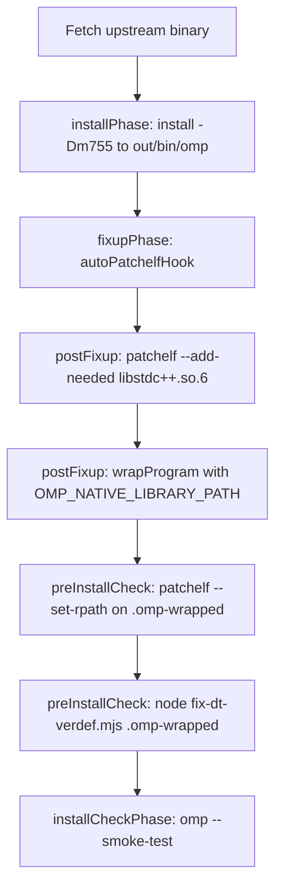

# Architecture & Reference: Upstream Binary to Nix Patching (`omp-bin`)

This document details the internal architecture of the upstream `oh-my-pi` (`omp`) Linux binaries, how they are adapted for NixOS, why specific non-standard patching steps are mandatory, and operational guidelines for future maintainers.

---

## 1. Upstream Binary Anatomy

The upstream binary (`omp-linux-x64`, `omp-linux-arm64`) is produced using **Bun's single-file executable compiler** (`bun build --compile`).

```
+-------------------------------------------------------------------+
| Bun Executable ELF Container (x86_64 / aarch64)                  |
| - INTERP: /lib64/ld-linux-x86-64.so.2 (hardcoded glibc loader)    |
| - DT_NEEDED: libc, libpthread, libdl, libm, ld-linux              |
| - DT_VERDEF / .gnu.version_d: bun symbol version definitions      |
+-------------------------------------------------------------------+
| Virtual Filesystem (bunfs) [Embedded Compressed / Appended Data]  |
| - Application JS/TS bundles                                       |
| - Embedded Zstandard frames:                                      |
|     bunfs/root/pi_natives.linux-x64-modern.node.zst (~30 MB)      |
|     bunfs/root/pi_natives.linux-x64-baseline.node.zst (~30 MB)    |
+-------------------------------------------------------------------+
```

### Key Upstream Characteristics:
1. **Host Dynamic Dependencies**: The outer ELF binary links only basic C runtime libraries (`libc`, `libpthread`, `libdl`, `libm`). It does **not** declare dynamic links to `libstdc++`, `libasound`, or `libpulse`.
2. **Symbol Versioning**: Bun executables declare their own symbol versions via `.gnu.version_d` and reference them via `DT_VERDEF`.
3. **Runtime Self-Extraction of Native Addon**:
   - The core agent capabilities (syntax parsing, terminal PTY, desktop capture, audio, SQLite, vector search) live in `@oh-my-pi/pi-natives`, a Rust N-API shared library.
   - At startup, `@oh-my-pi/pi-natives` detects CPU capabilities (AVX2/modern vs baseline) and unpacks the appropriate zstd frame to:
     `$XDG_DATA_HOME/omp/natives/<version>/pi_natives.<platform>-<arch>-<variant>.node` (or `~/.omp/natives/<version>/`).
   - The decompressed addon is an unstripped 115 MB ELF shared object.

---

## 2. Failure Modes on NixOS

When running the raw upstream binary on NixOS, three failure layers emerge:

| Layer | Problem | Manifestation |
|-------|---------|---------------|
| **1. ELF Interpreter** | Upstream requests `/lib64/ld-linux-x86-64.so.2`. Pure NixOS environments lack `/lib64` outside of legacy compatibility paths. | `execve(): No such file or directory` |
| **2. DT_VERDEF Relocation Bug** | When `patchelf` grows `.dynamic` to add RPATHs, it relocates `.gnu.version_d` but leaves `DT_VERDEF` pointing to the old address ([NixOS/patchelf#664](https://github.com/NixOS/patchelf/issues/664)). | `glibc`'s `_dl_check_map_versions` dereferences invalid memory: **SIGSEGV / crash before `main()`** |
| **3. Extracted Addon Dependencies** | The native addon (`.node`) is extracted at runtime from a compressed blob. Standard build-time tools (`autoPatchelfHook`) cannot inspect or patch it. The addon requires `libstdc++` (C++ runtime) and dynamically opens (`dlopen`) audio libraries (`libpulse.so.0`, `libpulse-simple.so.0`, `libasound.so.2`). | Runtime crash or missing audio capabilities during runtime operations |

---

## 3. The Nix Patching Pipeline

The packaging in `package.nix` coordinates a specialized sequence:



### Why Each Step Is Necessary

### Step 1: `autoPatchelfHook`
- **What it does**: Inspects the binary, resolves dynamic requirements against `buildInputs`, and rewrites `PT_INTERP` to the Nixpkgs glibc dynamic linker and populates `DT_RUNPATH`.
- **Limitation**: Only inspects what is already listed in `DT_NEEDED`. It does not know about libraries needed by runtime-extracted `.node` files.

### Step 2: `patchelf --add-needed libstdc++.so.6 "$out/bin/omp"`
- **Why**: Rust and C++ dependencies inside the extracted addon need `libstdc++.so.6`.
- **Mechanism**: Adding `libstdc++.so.6` to the main binary's `DT_NEEDED` forces glibc to load it globally when `omp` boots. When the addon is later `dlopen`ed into the same process, its `libstdc++` symbols resolve immediately against the loaded binary space without needing an internal RPATH.

### Step 3: `wrapProgram ... --set-default OMP_NATIVE_LIBRARY_PATH "${nativeLibraryPath}"`
- **Why**: Upstream `oh-my-pi` has an explicit environment variable hook for Linux:
  ```ts
  function I(r, e) {
    if (e !== "linux") return {};
    const n = r.OMP_NATIVE_LIBRARY_PATH;
    if (typeof n !== "string" || n.length === 0) return {};
    const t = r.LD_LIBRARY_PATH;
    return { LD_LIBRARY_PATH: t ? `${t}:${n}` : n };
  }
  ```
- **Mechanism**: Any worker thread, sub-agent, or spawned helper process created by `omp` inherits `LD_LIBRARY_PATH` augmented with `OMP_NATIVE_LIBRARY_PATH`. Setting this ensures child processes and external tools locate GCC runtime libraries (`stdenv.cc.cc.lib`).

### Step 4: `preInstallCheck` RPATH Reinforcement
- **Why**: `wrapProgram` produces a binary wrapper (`out/bin/omp`) that calls `out/bin/.omp-wrapped`.
- The extracted addon performs runtime `dlopen` for audio libraries:
  - `libpulse.so.0` / `libpulse-simple.so.0`
  - `libasound.so.2`
- By forcing `out/bin/.omp-wrapped` to have an explicit `RPATH` containing `glibc`, `stdenv.cc.cc.lib`, `libpulseaudio`, and `alsa-lib`, the glibc dynamic linker's search path accommodates these dependencies when `dlopen` is called from threads within the primary process.

### Step 5: `fix-dt-verdef.mjs`
- **Why**: Every time `patchelf` adds a `DT_NEEDED` entry or extends the RPATH, it must expand the `.dynamic` section. In doing so, it moves the cluster containing `.gnu.version_d` to higher virtual memory, but leaves the `DT_VERDEF` dynamic entry pointing to the pre-relocation address.
- **The Repair Script**:
  1. Opens the target ELF64 little-endian binary read/write.
  2. Parses section headers to find `SHT_GNU_VERDEF` (`.gnu.version_d`) and reads its new virtual address (`sh_addr`).
  3. Locates the `SHT_DYNAMIC` section (`.dynamic`).
  4. Scans the dynamic tag entries for `DT_VERDEF` (`0x6ffffffc`).
  5. Overwrites the 8-byte value pointer with the actual `.gnu.version_d` virtual address.
- **Timing**: Must be executed as the **very last step** after all `patchelf` operations are finished.

### Step 6: `installCheckPhase` Smoke Test
- Runs `"$out/bin/omp" --smoke-test` in an isolated temporary `$HOME`.
- Asserts that output contains `smoke-test: ok`.
- Ensures both the Bun runtime and the N-API native extraction pipeline boot and validate cleanly.

---

## 4. Maintenance & Upgrade Guidelines

### When Updating Upstream Versions
1. Run `./update.sh` (or `./update.sh <version>`).
2. Run `nix build .#omp`.
3. If the build or smoke test fails:
   - Check if `DT_VERDEF` offsets changed or if Bun updated its ELF layout.
   - Check if upstream extracted addon added new dynamic dependencies via:
     ```bash
     H=$(mktemp -d); X=$(mktemp -d); mkdir -p "$X/omp"
     HOME=$H XDG_DATA_HOME=$X ./result/bin/omp --smoke-test
     readelf -d $X/omp/natives/*/*.node | grep NEEDED
     strings -a $X/omp/natives/*/*.node | grep -E '^lib[a-zA-Z0-9_-]+\.so'
     ```
   - If new shared objects are dynamically loaded, add them to `runtimeLibraryPath` in `package.nix`.

### Fragility Note
Because final `patchelf` and `fix-dt-verdef.mjs` calls currently reside in `preInstallCheck`, running `nix build --no-check` would produce a binary missing these final adjustments. In future refactoring, these operations can be moved into a dedicated `postFixup` step executed on `$out/bin/.omp-wrapped` immediately after `wrapProgram`.
